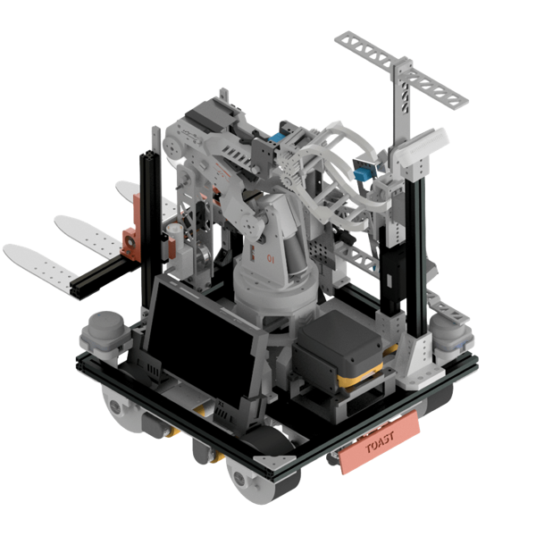
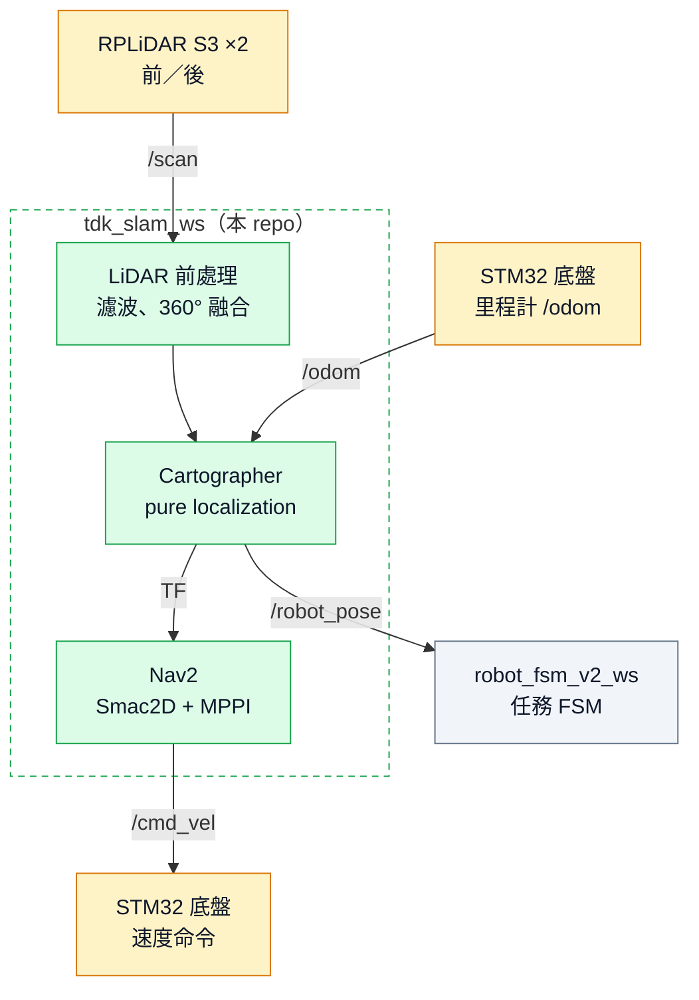
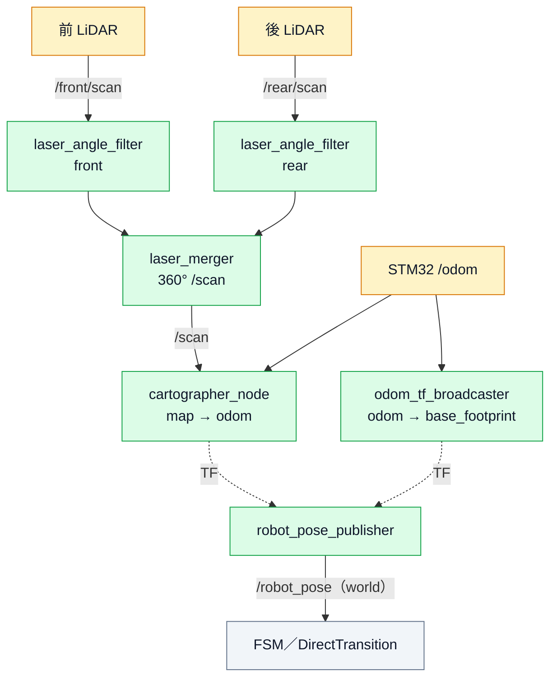
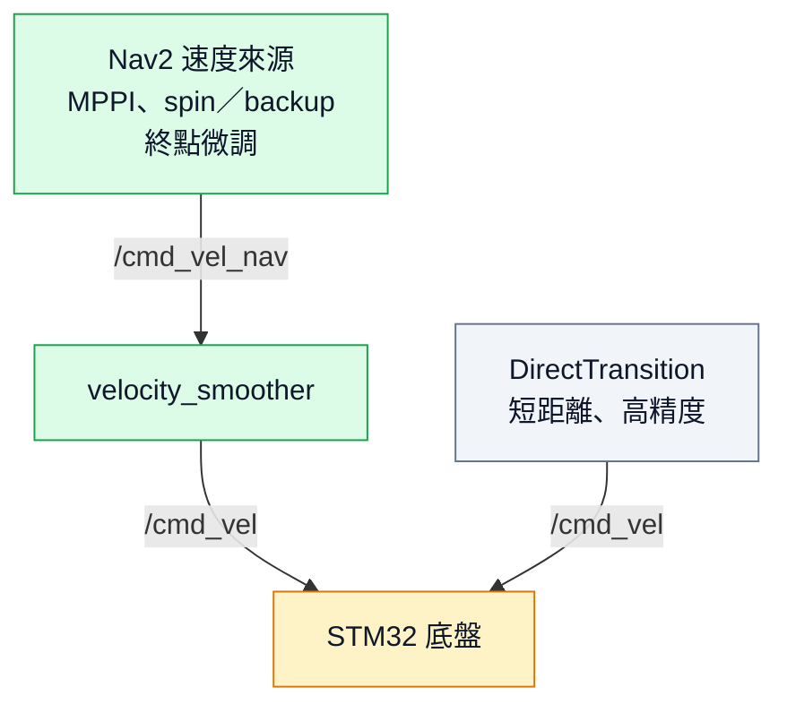
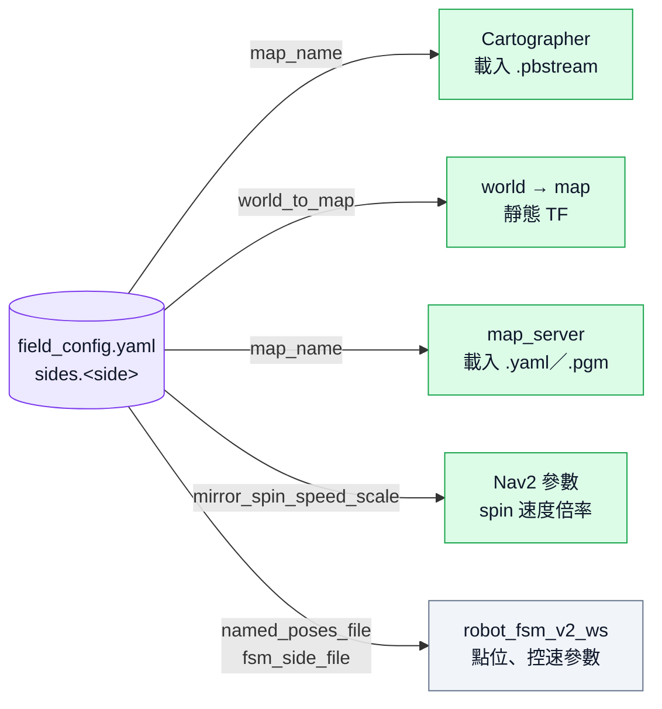
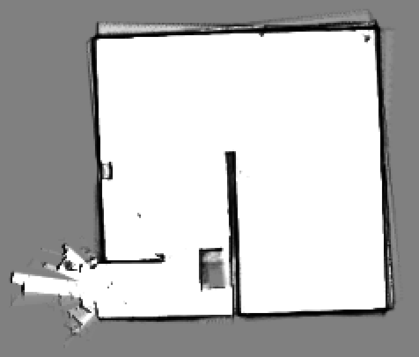
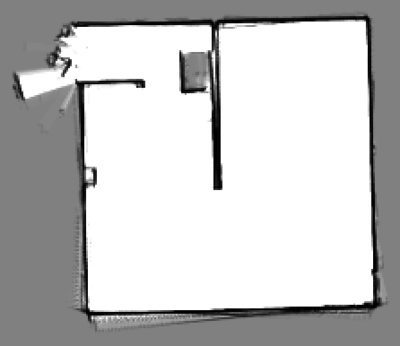
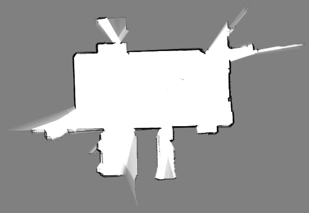
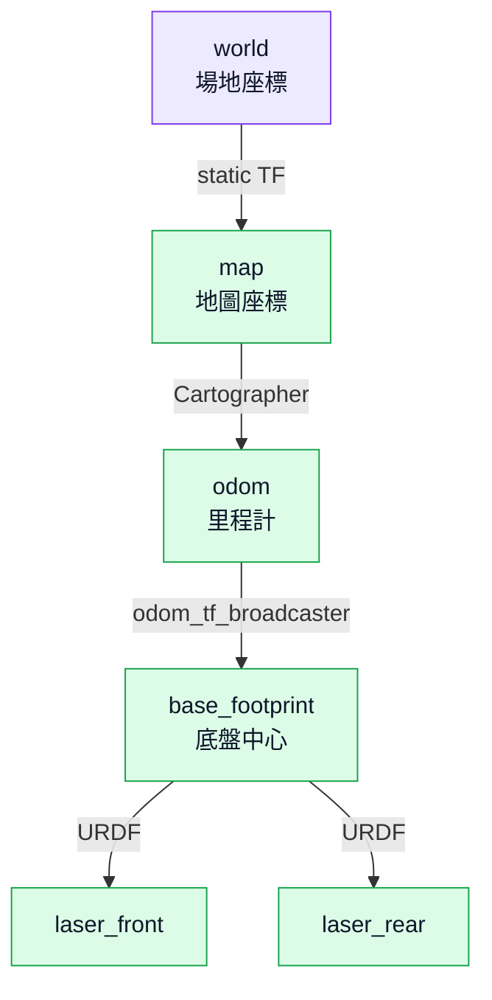
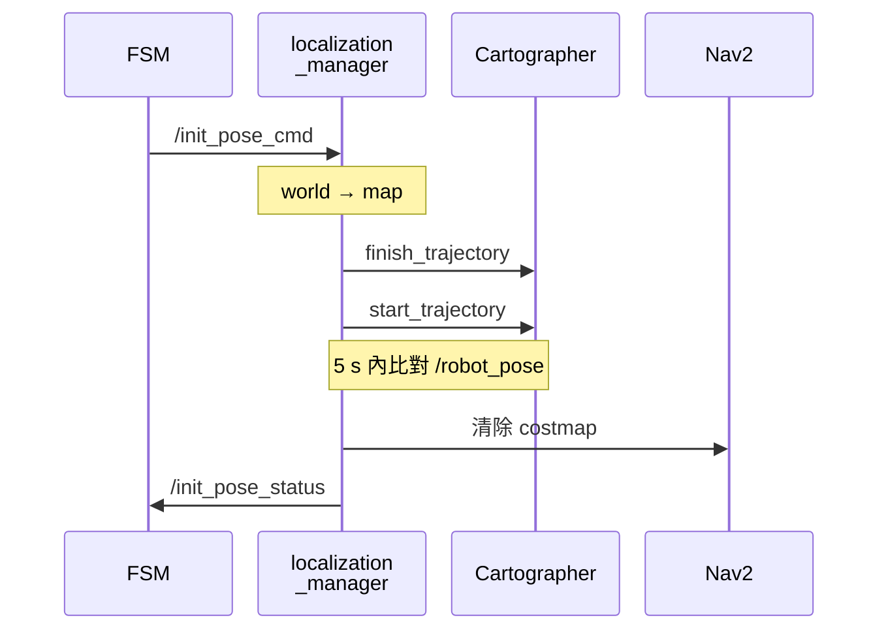

# TDK 30th — tdk_slam_ws（定位與導航）

TDK 第 30 屆機器人競賽的**定位 + 導航** workspace。負責雙 LiDAR 前處理、Cartographer 定位、TF 樹與 Nav2 導航，並提供「場地座標（world frame）」的機器人位置給主程式使用。

<p align="center">
  
</p>

<!-- 🎬 預留：機器人實機跑機影片（整場比賽或完整測試，建議 30 秒～1 分鐘） -->

| 項目 | 內容 |
| --- | --- |
| 分支 | `tmep_ver` |
| 環境 | Ubuntu 22.04／ROS 2 Humble／Docker，CycloneDDS，`ROS_DOMAIN_ID=30` |
| 底盤 | 麥克納姆輪（全向），RPLiDAR S3 ×2（前／後） |

本 ws 是整台機器人軟體的其中一塊，搭配以下 workspace 一起運作：

| Workspace | 負責 |
| --- | --- |
| **tdk_slam_ws**（本 repo） | 感測器前處理、定位、TF、Nav2 |
| [`robot_fsm_v2_ws`](https://github.com/terryking0711/robot_fsm_v2_ws/tree/real-robot-test) | 比賽任務 FSM、named pose 導航、DirectTransition 控速、robot_panel 後端 |
| `microros_ws` | STM32 micro-ROS agent（底盤／機構），以及 rosbridge、foxglove_bridge 等常駐 bridge |
| [`robot_panel_ui`](https://github.com/terryking0711/robot_panel_ui) | 瀏覽器控制面板（狀態監控、一鍵啟動比賽） |

## 目錄

1. [系統架構](#1-系統架構)
2. [Docker 快速開始](#2-docker-快速開始)
3. [啟動方式](#3-啟動方式)
4. [場地與地圖設定](#4-場地與地圖設定)
5. [TF Tree](#5-tf-tree)
6. [初始定位流程](#6-初始定位流程)
7. [套件與節點](#7-套件與節點)
8. [Nav2 設定](#8-nav2-設定)

---

## 1. 系統架構

### 整體資料流



> 綠色：本 repo　灰色：其他 repo　黃色：硬體。FSM 如何下達導航目標、何時改用 DirectTransition，見 [robot_fsm_v2_ws 的移動控制](https://github.com/terryking0711/robot_fsm_v2_ws/tree/real-robot-test#3-移動控制)。

### 定位 pipeline



- 這兩條 pipeline 由 `tdk_slam_manager` 的 `spawn_launch.py` 啟動。
- 各節點的輸入輸出見[自寫節點](#自寫節點tdk_slam_manager)。

<!-- 📷 預留：前後 LiDAR 安裝位置照片，或融合前（/front/scan、/rear/scan）與融合後（/scan）的對比截圖 -->

### 常駐服務與硬體連線

以下服務跑在 `microros_ws/docker` 的獨立 container，不隨定位／導航重啟：

| 服務 | 連線 | 用途 |
| --- | --- | --- |
| `rosbridge_websocket` | `:9090` | `robot_panel_ui` 與 ROS 之間的 WebSocket |
| `foxglove_bridge` | `:8767` | Foxglove／Lichtblick 檢視地圖、TF、named_poses |
| micro-ROS agent fast | `/dev/stm32_fast`・1M baud | STM32 底盤：mecanum 控制 + 里程計 |
| micro-ROS agent slow | `/dev/stm32_slow`・115200 | STM32 機構 |

### 速度命令路徑

底盤只吃一個 `/cmd_vel`，但有兩種來源，由 FSM 依任務階段決定由誰控制：



- **Nav2（長距離、需避障）**：所有 Nav2 內部速度（MPPI controller、behavior 的 spin／backup、`navigation_server` 的終點微調）都先 remap 到 `/cmd_vel_nav`，再經 `velocity_smoother` 輸出 `/cmd_vel`。這樣 `/cmd_vel` 只會有一個 Nav2 的 publisher，不會被 recovery 行為繞過 smoother。
- **DirectTransition（短距離、高精度）**：在 `robot_fsm_v2_ws`。入口對位、轉角、放置點這類「路線固定、要求 cm 級精度」的段落，不走 Nav2，直接依 `/robot_pose` 計算速度。
  - 每個目標點的 `max_speed`、`max_accel`／`max_decel`、`xy_tolerance`、`yaw_tolerance_deg`、`settle_cycles` 都寫在 `fsm_side_<side>.yaml`。
  - 改完重啟 FSM 就生效。

---

## 2. Docker 快速開始

每個 workspace 都有自己的 `docker/`，可以單獨 build 與執行。本 ws 的 image 已裝好所有相依套件。`src/` 內的第三方套件（`ira_laser_tools`、`rplidar_ros`、`nav2_smac_planner`）都直接放在 repo 中，不需要 submodule。

```bash
# 1. clone（實機使用 tmep_ver 分支）
git clone -b tmep_ver https://github.com/terryking0711/tdk_slam_ws.git
cd tdk_slam_ws/docker

# 2. build image + 啟動 container（第一次約 10~20 分鐘）
./docker_run.sh             # 會自動帶入主機 UID/GID 並開放 X11

# 3. 進入 container
docker exec -it tdk_slam bash

# 4. 在 container 內 build（工作目錄就是 ~/tdk_slam_ws）
colcon build --symlink-install
source install/setup.bash
```

| 項目 | 說明 |
| --- | --- |
| 快捷指令 | `cb` = build + source，`sw` = source `install/setup.bash` |
| 自動 source | 新開 `docker exec -it tdk_slam bash` 會自動 source `install/setup.bash` |
| GUI（rviz2） | 主機需 `xhost +local:docker`（`docker_run.sh` 已包含） |
| UID 不是 1000 | 請用 `./docker_run.sh`，否則 `build/ install/ log/` 的擁有者會錯 |
| 環境變數 | `ROS_DOMAIN_ID`（預設 30）、`RMW_IMPLEMENTATION`（預設 cyclonedds）可覆蓋 |
| 改 Dockerfile 後 | `docker compose up -d --build`；關閉：`docker compose down` |

> [!WARNING]
> `spawn_launch.py` 與 `nav_launch.py` 會讀 `/workspaces/field_config.yaml`（見[場地與地圖設定](#4-場地與地圖設定)），container 內必須能存取到這個路徑。

### LiDAR 裝置

前後 LiDAR 用 udev symlink 固定裝置名稱，避免插拔後 `/dev/ttyUSB*` 順序對調：

| 裝置 | 路徑 | namespace／frame |
| --- | --- | --- |
| 前 LiDAR | `/dev/rplidar_front` | `/front`・`laser_front` |
| 後 LiDAR | `/dev/rplidar_rear` | `/rear`・`laser_rear` |

---

## 3. 啟動方式

### 前置：micro-ROS 與 bridge

STM32 的 micro-ROS agent（fast／slow 兩條 serial）和 rosbridge、foxglove_bridge 等常駐服務，跑在 `microros_ws/docker` 的獨立 container 裡。它們不必跟著定位／導航一起重啟，所以要先啟動。

對應桌面 icon：`TDK MicroROS`（按一次啟動、再按一次關閉）。

### 方式一：一鍵啟動（比賽用）

桌面 icon 會在 tmux 裡同時開好定位、導航、`fsm_launcher` 與 named_poses 標記：

| 桌面 icon | 等同指令 | 用途 |
| --- | --- | --- |
| `TDK Loc_Normal` | `start.sh normal` | 比賽 Normal 場地 |
| `TDK Loc_Mirror` | `start.sh mirror` | 比賽 Mirror 場地 |
| `TDK Loc_DIT` | `start.sh dit` | 實驗室測試場地 |
| `TDK Mapping+Nav` | `start_mapping.sh` | Cartographer 建圖 + Nav2 |

1. 先啟動 `TDK MicroROS`。
2. 按下對應場地的 `TDK Loc_*` icon。
3. 用 `TDK Robot Panel` 打開 [`robot_panel_ui`](https://github.com/terryking0711/robot_panel_ui)，確認各項狀態燈正常。
4. 按下與已載入地圖**相同 side** 的 `START`。`fsm_launcher` 會擋下 side 不一致的啟動請求。

> [!TIP]
> 再按一次同一個 icon（或換另一個 side）時，會先對所有 pane 送 Ctrl-C 正常關閉，再重新啟動。換場地也是用這個方式。

### 方式二：手動啟動

```bash
# Terminal 1 — LiDAR + 前處理 + TF + 定位
ros2 launch tdk_slam_manager spawn_launch.py localization_mode:=cartographer field_side:=normal

# Terminal 2 — map_server + Nav2
ros2 launch tdk_nav2_manager nav_launch.py field_side:=normal

# Terminal 3 — 主程式（於 robot_fsm_v2_ws）
ros2 launch robot_fsm robot_bringup.launch.py field_side:=normal
```

### Launch 參數

**`spawn_launch.py`**

| 參數 | 預設 | 說明 |
| --- | --- | --- |
| `localization_mode` | `mapping` | 見下表 |
| `field_side` | 空（= `default_side`） | `normal`／`mirror`／`dit`，決定 pbstream 與 world→map |
| `use_sim_time` | `false` | |

| `localization_mode` | 用途 | 狀態 |
| --- | --- | --- |
| `cartographer` | **比賽主定位**：pure localization 讀 pbstream | ✅ 比賽使用 |
| `carto_mapping` | Cartographer 建圖（`/carto_map` 視覺化） | ✅ 可用 |
| `mapping` | slam_toolbox 建圖 | ✅ 可用 |
| `slam_toolbox` | slam_toolbox 定位 | ⚠️ 尚未測試 |
| `amcl` | AMCL 定位（備援） | ⚠️ 尚未測試 |

**`nav_launch.py`**

| 參數 | 預設 | 說明 |
| --- | --- | --- |
| `field_side` | 空（= `default_side`） | 決定 map_server 地圖與 spin 速度倍率 |
| `map` | 空 | 指定地圖 yaml 完整路徑；留空則依 `field_side` 自動選 |
| `nav_params_file` | `config/tdk_nav2_params.yaml` | Nav2 參數檔 |
| `use_sim_time` | `false` | |

---

## 4. 場地與地圖設定

比賽場地分 **Normal／Mirror** 兩側，另有實驗室的 **DIT** 測試場地。所有跟場地有關的設定都集中在 `/workspaces/field_config.yaml`，定位、導航、FSM 三邊讀的是同一份，所以選 side 時只要指定一次：



| side | 地圖 | named_poses | FSM 設定 | 備註 |
| --- | --- | --- | --- | --- |
| `normal` | `map_normal` | `named_poses_normal.yaml` | `fsm_side_normal.yaml` | 比賽 Normal 場地 |
| `mirror` | `map_mirror` | `named_poses_mirror.yaml` | `fsm_side_mirror.yaml` | 比賽 Mirror 場地 |
| `dit` | `real_map_0` | `named_poses_dit.yaml` | `fsm_side_mirror.yaml` | 實驗室場地，控速沿用 mirror |

- `field_config.yaml` 裡的路徑都指向 `src/`，修改後下次 launch 就生效，**不需要重新 colcon build**。
- mirror／dit 會讀 `fsm_side_*.yaml` 的 `mirror_spin_speed_scale`，同時放大 `behavior_server` 與 `velocity_smoother` 的角速度、角加速度限制，平移參數不變。產生的暫存參數檔在 launch 結束時自動刪除。

### 建圖結果

由 `src/tdk_slam_manager/maps/*.pgm` 轉成的圖片（白：可通行，黑：障礙，灰：未知）。

| Normal（`map_normal`） | Mirror（`map_mirror`） | DIT（`real_map_0`） |
| :---: | :---: | :---: |
|  |  |  |

地圖上的 named poses 與移動疊圖，見 [robot_fsm_v2_ws 的開發與視覺化工具](https://github.com/terryking0711/robot_fsm_v2_ws/tree/real-robot-test#4-開發與視覺化工具)。

### 建立新地圖

1. 啟動建圖模式：`start_mapping.sh`，或 `spawn_launch.py localization_mode:=carto_mapping`。
2. 遙控機器人跑完整個場地。
3. 存檔：`.pbstream` 給 cartographer 定位，`.yaml/.pgm` 給 map_server。

   ```bash
   ros2 service call /finish_trajectory cartographer_ros_msgs/srv/FinishTrajectory "{trajectory_id: 0}"
   ros2 service call /write_state cartographer_ros_msgs/srv/WriteState \
     "{filename: '<ws 絕對路徑>/src/tdk_slam_manager/maps/<name>.pbstream', include_unfinished_submaps: true}"
   ros2 run nav2_map_server map_saver_cli -f src/tdk_slam_manager/maps/<name> \
     --ros-args -r map:=/carto_map -p map_subscribe_transient_local:=true
   ```

4. 在 `field_config.yaml` 把對應 side 的 `map_name` 改成 `<name>`。

<!-- 🎬 預留：Cartographer 建圖過程影片（rviz2 或 Foxglove 畫面，可加速播放） -->

---

## 5. TF Tree



| Transform | 發布者 | 說明 |
| --- | --- | --- |
| `world → map` | `static_transform_publisher` | 讀 `field_config.yaml` 的 `world_to_map` |
| `map → odom` | `cartographer_node`（pure localization） | 低頻全域校正（會跳動） |
| `odom → base_footprint` | `odom_tf_broadcaster`（自寫） | 轉發 `/odom` pose，使用上位機時間戳；原規劃 EKF，暫時停用 |
| `base_footprint → laser_*` | `robot_state_publisher`（URDF） | 前後 LiDAR 安裝位置 |

| Frame | 說明 |
| --- | --- |
| **world** | 場地左下角為原點。比賽規則、named_poses、FSM 都用場地座標。`/robot_pose` 就是 `world → base_footprint`。 |
| **map** | Cartographer 的地圖座標。原點在建圖起點（= 比賽出發點），所以每張地圖的 world→map 偏移要在 `field_config.yaml` 裡設好。 |
| **odom** | 里程計座標系。 |
| **base_footprint** | 底盤投影中心。 |

LiDAR 外參寫在 `config/robot_params.yaml`。前後 LiDAR 的 yaw 若有偏差，可在長直走廊靜止時執行 `scripts/calibrate_lidar_yaw.py` 估計修正量。

<!-- 🎬 預留：Foxglove 定位畫面（地圖 + TF + /robot_pose 跟著實機移動），可直接沿用 robot_fsm_v2_ws 的 Foxglove 測試影片 -->

---

## 6. 初始定位流程

比賽時把機器人擺在出發點即可開始定位：建圖時的原點就是比賽出發點，所以 Cartographer pure localization 啟動後，機器人的初始位置剛好對應到地圖原點。

`localization_manager` 另外提供「把機器人重設到指定位姿」的流程，收到 `/init_pose_cmd` 後重建 Cartographer trajectory 並驗證：



1. FSM 送出 `/init_pose_cmd`（world frame）。
2. `localization_manager` 做 world → map 座標轉換（減去 `world_to_map`）。
3. 呼叫 `/finish_trajectory` 結束舊軌跡，再以目標 pose 為起點呼叫 `/start_trajectory`。
4. 在 5 s 內持續比對 `/robot_pose`，誤差需小於 0.15 m／0.15 rad。
5. 清除 Nav2 的 global／local costmap，回報 `/init_pose_status = true`。

驗證失敗或逾時會回到 IDLE，可重新送 `/init_pose_cmd`。

---

## 7. 套件與節點

| 套件 | 內容 |
| --- | --- |
| `tdk_slam_manager` | 自寫節點、cartographer／slam_toolbox／AMCL／EKF 設定、URDF、地圖、`spawn_launch.py` |
| `tdk_nav2_manager` | Nav2 參數（多組可切換）、costmap、behavior tree、`nav_launch.py`（含獨立的 map_server） |
| `nav2_smac_planner` | Smac Planner 原始碼（參考 Eurobot 隊伍版本，vendored） |
| `rplidar_ros` | RPLiDAR S3 驅動（vendored） |
| `ira_laser_tools` | 雙 LiDAR 融合（nakai-omer humble fork，vendored） |

### 自寫節點（`tdk_slam_manager`）

| 節點 | 輸入 | 輸出 | 功能 |
| --- | --- | --- | --- |
| `laser_angle_filter` | `/front/scan`、`/rear/scan` | `/*/scan_filtered` | 遮掉指定角度區間（車體結構），並濾除 `self_clearance`（0.20 m）以內打到車身的點 |
| `odom_tf_broadcaster` | `/odom` | TF `odom → base_footprint` | 直接轉發 STM32 里程計，改用上位機時間戳，避免與 LiDAR 時間不同步 |
| `robot_pose_publisher` | TF `world → base_footprint` | `/robot_pose` | 輸出場地座標的機器人位置，給 FSM／DirectTransition 使用 |
| `localization_manager` | `/init_pose_cmd`、`/robot_pose` | `/init_pose_status` | 初始定位狀態機（見[初始定位流程](#6-初始定位流程)） |

### 主要設定檔

| 檔案 | 內容 |
| --- | --- |
| `config/robot_params.yaml` | 底盤尺寸、LiDAR 外參 |
| `config/laser_merger_params.yaml` | 雙 LiDAR 融合參數 |
| `cartographer_config/cartographer_2d.lua` | Cartographer 建圖 |
| `cartographer_config/localization.lua` | Cartographer pure localization |
| `config/ekf_config.yaml` | EKF（目前停用，保留待修） |

---

## 8. Nav2 設定

目前比賽使用 **Smac2D planner + MPPI controller（Omni motion model）**，適合麥克納姆輪全向移動。主要參數在 `config/tdk_nav2_params.yaml`：

| 項目 | 值 |
| --- | --- |
| `vx_max`／`vy_max` | 0.8 m/s |
| `wz_max` | 0.6 rad/s |
| `xy_goal_tolerance` | 0.04 m |
| `yaw_goal_tolerance` | 0.03 rad |

`config/` 另外保留了開發期間比較過的組合，可用 `nav_params_file:=` 切換：

| 檔案 | 組合 |
| --- | --- |
| `tdk_nav2_params.yaml` | **Smac2D + MPPI（比賽使用）** |
| `smac_2d_params.yaml` | Smac2D |
| `smac_lattice_params.yaml` | Smac Lattice |
| `theta_star_params.yaml` | Theta* |
| `mppi_params.yaml` | MPPI |
| `dwb_params.yaml` | DWB |

<!-- 📷 預留：Nav2 規劃畫面截圖（global path + costmap），或實機 Nav2 移動影片；robot_fsm_v2_ws 的「使用 Nav2 的實機效果」影片可沿用 -->
